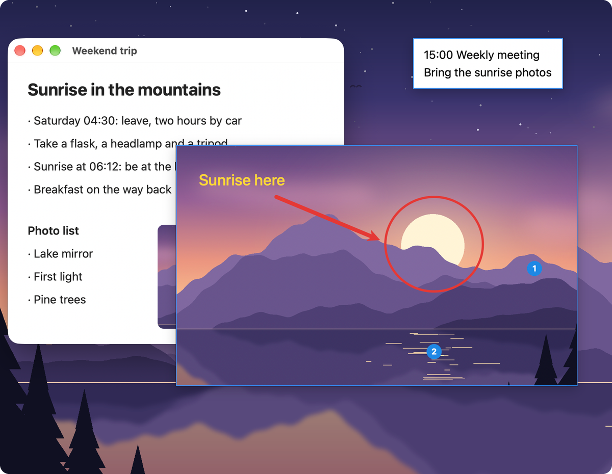

> [!IMPORTANT]
> **sniplite for Mac.** This repository maintains only the **macOS** version (in [`macos`](macos/README.md); download it from [Releases](https://github.com/codeime/sniplite/releases/latest)). For **Windows**, download sniplite from the original repository: [MrTangLuyao/sniplite](https://github.com/MrTangLuyao/sniplite/releases/latest).

<div align="center">


# sniplite

**A tiny, fast screenshot and pin tool for macOS**

[](README.md) [](docs/README.zh-CN.md) [](docs/README.zh-TW.md) [](docs/README.ja.md) [](docs/README.ko.md) [](docs/README.fr.md) [](docs/README.de.md) [](docs/README.es.md)

[](https://github.com/codeime/sniplite/releases) [](#download) [](LICENSE)

[**Download**](#download) | [Default shortcuts](#default-shortcuts) | [FAQ](#faq)


<br>
 
<br>


</div>

## Features

- **Fast**: press F1 and the capture is ready at once, on every display
- **Finds what you point at**: the window, or the part of a window (a button, a field, a list) under the mouse is selected for you; the wheel steps out to bigger parts
- **Draw**: rectangles, ellipses, lines, arrows, pen, marker, text, numbers and mosaic, each with its own size and opacity; anything drawn can be selected and changed again
- **Pins**: pin a capture, or what you copied, above every window; zoom it, fade it, draw on it again
- **Text recognition**: read the text of a capture, tables included, with Apple's Vision on this Mac (optional, off by default)
- **Light**: about 2 MB, native on Apple Silicon and Intel, about 15–25 MB of memory while idle
- **Clean**: open source, no ads, nothing collected, nothing uploaded
- **Languages**: English, 简体中文, 繁體中文, following the system unless you pick one

## Download

Get `sniplite_<version>_macos.zip` from [Releases](https://github.com/codeime/sniplite/releases/latest), unzip it and move `sniplite.app` to Applications. It needs macOS 14 Sonoma or later.

sniplite is not notarized by Apple, so macOS blocks it at first ("cannot be opened" or "is damaged"). After moving it to Applications, run this once:

```bash
xattr -dr com.apple.quarantine "/Applications/sniplite.app"
```

> [!TIP]
> sniplite lives in the menu bar (four corner marks with a bolt) and has no Dock icon. On first start it shows what to allow: Screen Recording to capture, and Accessibility for the F1–F12 keys and for finding the parts of windows.

## Default shortcuts

| Key | What it does |
| --- | --- |
| **F1** | Capture |
| **⇧F1** | Quick capture: the screen under the mouse straight to a file (when turned on in Settings) |
| **F3** | Pin the copied image or text |
| **⇧F3** | Hide / show all pins |
| **F4** / **⇧F4** | Capture and read / copy the text (when text recognition is on) |
| **Enter** / double-click | Copy the capture |
| **⌘S** | Save the capture |
| **⌘T** / middle click | Pin the capture |
| **⌘Z** / **⇧⌘Z** | Undo / redo |
| **Esc** / right click | One step back; at the end, cancel |
| **Arrow keys**, **W A S D** | Move by one pixel; with Shift, by ten |
| **Wheel** / two fingers | Choosing: a bigger or smaller part; with a tool: its size; on a pin: zoom |
| **⌥ + wheel** | With a tool: its opacity; on a pin: the pin's opacity |
| **⌘E** (on a pin) | Draw on the pin again |

Every shortcut is listed in [the macOS README](macos/README.md#shortcuts); the global ones can be changed in Settings.

## FAQ

**Why does macOS say sniplite "cannot be opened" or "is damaged"?**

It is not notarized by Apple. Run the `xattr` command under [Download](#download) once: it removes the mark macOS puts on downloaded files.

**Why does F1 change the brightness instead?**

The F1–F12 shortcuts need the Accessibility permission (called "Device Control and Data Access" on macOS 27). Allow it from the menu bar icon, under Permissions….

**Do I have to allow the permissions again after an update?**

Usually yes: sniplite is signed ad hoc, so macOS sees each version as a new app. sniplite clears the old entries itself and shows its permissions page; drag it into the list again.

**How do I read the text in a capture?**

Turn on Text recognition in Settings › General. Then use the text buttons on the toolbar, ⌘O, or F4 / ⇧F4. It runs with Apple's Vision on this Mac; nothing is uploaded.

**How much memory does it use?**

About 15–25 MB while idle. A capture holds the picture of the screen only while it is open, then lets it go.

**Where are its settings and log?**

The settings are the app's preferences (`defaults read io.github.codeime.sniplite`); a short log of shortcuts, permissions and recognition times is in `~/Library/Logs/sniplite.log`.

**How do I uninstall it?**

Quit it from the menu bar and delete `sniplite.app` from Applications. To remove its settings too, run `defaults delete io.github.codeime.sniplite`; if it is still listed under Privacy & Security in System Settings, remove it there.

**Is there a Windows version?**

Yes, the original: [MrTangLuyao/sniplite](https://github.com/MrTangLuyao/sniplite/releases/latest).

## Settings


## Build it yourself

Only the Xcode Command Line Tools are needed (`xcode-select --install`); Xcode itself is not.

```bash
cd macos
./build.sh          # -> build/sniplite.app (Apple Silicon + Intel)
./build.sh --zip    # also build/sniplite_<version>_macos.zip
./test.sh           # unit tests
```

The source is in `macos/Sources`, written in Swift with AppKit; signing and a map of the code are in [`macos`](macos/README.md). Pushing a tag `macos-v<version>` builds the app with GitHub Actions and publishes it on Releases. The Windows source in `src` comes from the original repository and is not built here.

## License

[MIT](LICENSE)

## Third-party open source

sniplite for Mac uses nothing but what comes with macOS: ScreenCaptureKit to capture, the Accessibility API to find windows and their parts, and Vision to read text. No third-party code or models are included.

The drag-to-authorize panel follows the approach of [PermissionFlow](https://github.com/jaywcjlove/PermissionFlow) by jaywcjlove (MIT License), rewritten in AppKit.
