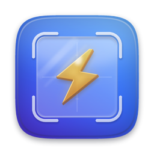
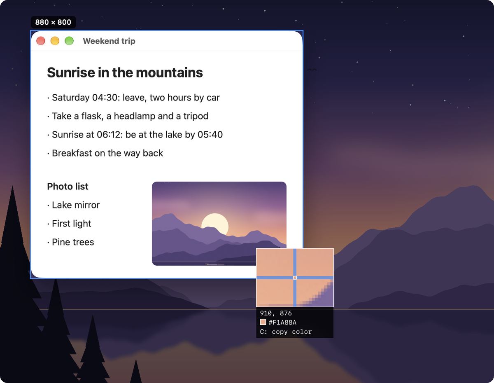

> [!IMPORTANT]
> **sniplite for Mac.** Este repositorio solo mantiene la versión de **macOS** (en [`macos`](../macos/README.md); descárgala desde [Releases](https://github.com/codeime/sniplite/releases/latest)). Para **Windows**, descarga sniplite desde el repositorio original: [MrTangLuyao/sniplite](https://github.com/MrTangLuyao/sniplite/releases/latest).

<div align="center">



# sniplite

**Una herramienta diminuta y rápida para capturar la pantalla y fijar imágenes en macOS**

[](../README.md) [](README.zh-CN.md) [](README.zh-TW.md) [](README.ja.md) [](README.ko.md) [](README.fr.md) [](README.de.md) [](README.es.md)

[](https://github.com/codeime/sniplite/releases) [](#descargar) [](../LICENSE)

[**Descargar**](#descargar) | [Atajos predeterminados](#atajos-predeterminados) | [Preguntas frecuentes](#preguntas-frecuentes)


<br>
 
<br>


</div>

## Características

- **Rápida**: pulsa F1 y la captura está lista al instante, en todas las pantallas
- **Encuentra lo que señalas**: la ventana, o la parte de una ventana (un botón, un campo, una lista) bajo el ratón se selecciona sola; la rueda pasa a partes más grandes
- **Dibujo**: rectángulos, elipses, líneas, flechas, lápiz, marcador, texto, números y mosaico, cada uno con su tamaño y opacidad; todo lo dibujado se puede seleccionar y cambiar después
- **Fijar**: fija una captura, o lo que copiaste, sobre todas las ventanas; amplíala, cambia su opacidad, vuelve a dibujar en ella
- **Reconocimiento de texto**: lee el texto de una captura, tablas incluidas, con Vision de Apple en este Mac (opcional, desactivado por defecto)
- **Ligera**: unos 2,5 MB, nativa en Apple Silicon e Intel, unos 15–25 MB de memoria en reposo
- **Limpia**: código abierto, sin anuncios, no recoge ni envía nada
- **Idiomas**: English, 简体中文, 繁體中文, según el sistema

## Descargar

Descarga `sniplite_<versión>_macos.zip` desde [Releases](https://github.com/codeime/sniplite/releases/latest), descomprímelo y mueve `sniplite.app` a Aplicaciones. Necesita macOS 14 Sonoma o posterior.

sniplite no está notarizada por Apple, así que al principio macOS la bloquea («no se puede abrir» o «está dañada»). Tras moverla a Aplicaciones, ejecuta una vez:

```bash
xattr -dr com.apple.quarantine "/Applications/sniplite.app"
```

> [!TIP]
> sniplite está en la barra de menús (cuatro esquinas y un rayo) y no tiene icono en el Dock. La primera vez muestra qué permitir: Grabación de pantalla para capturar, y Accesibilidad para las teclas F1–F12 y para encontrar las partes de las ventanas.

## Atajos predeterminados

| Tecla | Qué hace |
| --- | --- |
| **F1** | Capturar |
| **⇧F1** | Captura rápida: la pantalla bajo el ratón directamente a un archivo (si está activada en los ajustes) |
| **F3** | Fijar la imagen o el texto copiado |
| **⇧F3** | Ocultar / mostrar todas las imágenes fijadas |
| **F4** / **⇧F4** | Capturar y leer / copiar el texto (con el reconocimiento activado) |
| **Intro** / doble clic | Copiar la captura |
| **⌘S** | Guardar |
| **⌘T** / clic central | Fijar |
| **⌘Z** / **⇧⌘Z** | Deshacer / rehacer |
| **Esc** / clic derecho | Un paso atrás; al final, cancelar |
| **Flechas**, **W A S D** | Mover un píxel; con Mayúsculas, diez |
| **Rueda** / dos dedos | Al elegir: una parte mayor o menor; con una herramienta: su tamaño; sobre una imagen fijada: zoom |
| **⌥ + rueda** | Con una herramienta: su opacidad; sobre una imagen fijada: su opacidad |
| **⌘E** (sobre una imagen fijada) | Volver a dibujar en ella |

Todos los atajos están en [el README de la versión de macOS](../macos/README.md#shortcuts); los globales se cambian en los ajustes.

## Preguntas frecuentes

**¿Por qué macOS dice que sniplite «no se puede abrir» o «está dañada»?**

No está notarizada por Apple. Ejecuta una vez el comando `xattr` de [Descargar](#descargar): quita la marca que macOS pone a los archivos descargados.

**¿Por qué F1 cambia el brillo?**

Los atajos F1–F12 necesitan el permiso de Accesibilidad (en macOS 27 se llama «Device Control and Data Access»). Actívalo desde el icono de la barra de menús, en Permissions….

**¿Hay que volver a dar los permisos tras actualizar?**

Normalmente sí: sniplite está firmada ad hoc, así que macOS ve cada versión como una app nueva. sniplite borra sola las entradas antiguas y abre su página de permisos; vuelve a arrastrarla a la lista.

**¿Cómo leo el texto de una captura?**

Activa Text recognition en Settings › General. Luego usa los botones de texto de la barra de herramientas, ⌘O, o F4 / ⇧F4. Funciona con Vision de Apple en este Mac; no se envía nada.

**¿Cuánta memoria usa?**

Unos 15–25 MB en reposo. Una captura solo guarda la imagen de la pantalla mientras está abierta y luego la suelta.

**¿Dónde están sus ajustes y su registro?**

Los ajustes están en las preferencias de la app (`defaults read io.github.codeime.sniplite`); un registro breve de atajos, permisos y tiempos de reconocimiento está en `~/Library/Logs/sniplite.log`.

**¿Cómo la desinstalo?**

Ciérrala desde la barra de menús y borra `sniplite.app` de Aplicaciones. Para borrar también sus ajustes, ejecuta `defaults delete io.github.codeime.sniplite`; si sigue en Privacidad y seguridad de los Ajustes del Sistema, quítala también ahí.

**¿Hay versión para Windows?**

Sí, la original: [MrTangLuyao/sniplite](https://github.com/MrTangLuyao/sniplite/releases/latest).

## Ajustes


## Compilarlo tú mismo

Solo hacen falta las herramientas de línea de comandos de Xcode (`xcode-select --install`), no Xcode.

```bash
cd macos
./build.sh          # -> build/sniplite.app (Apple Silicon + Intel)
./build.sh --zip    # también build/sniplite_<versión>_macos.zip
./test.sh           # pruebas unitarias
```

El código está en `macos/Sources`, escrito en Swift con AppKit; la firma y un mapa del código están en [`macos`](../macos/README.md). Al subir una etiqueta `macos-v<versión>`, GitHub Actions compila la aplicación y la publica en Releases. El código de la versión de Windows, en `src`, viene del repositorio original y aquí no se compila.

## Licencia

[MIT](../LICENSE)

## Software libre de terceros

sniplite para Mac solo usa lo que trae macOS: ScreenCaptureKit para capturar, la API de accesibilidad para encontrar las ventanas y sus partes, y Vision para leer el texto. No incluye código ni modelos de terceros.

El panel para autorizar arrastrando sigue el enfoque de [PermissionFlow](https://github.com/jaywcjlove/PermissionFlow) de jaywcjlove (licencia MIT), reescrito con AppKit.
