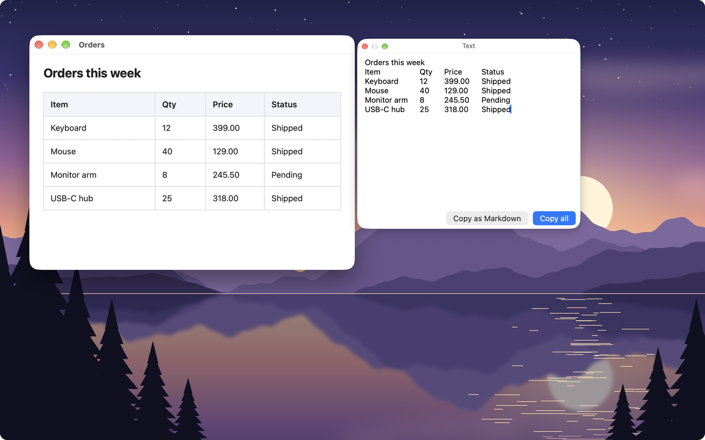

> [!IMPORTANT]
> **sniplite for Mac.** Ce dépôt ne maintient que la version **macOS** (dans [`macos`](../macos/README.md), à télécharger depuis les [Releases](https://github.com/codeime/sniplite/releases/latest)). Pour **Windows**, téléchargez sniplite depuis le dépôt d’origine : [MrTangLuyao/sniplite](https://github.com/MrTangLuyao/sniplite/releases/latest).

<div align="center">


# sniplite

**Un outil de capture d'écran et d'épinglage minuscule et rapide pour macOS**

[](../README.md) [](README.zh-CN.md) [](README.zh-TW.md) [](README.ja.md) [](README.ko.md) [](README.fr.md) [](README.de.md) [](README.es.md)

[](https://github.com/codeime/sniplite/releases) [](#télécharger) [](../LICENSE)

[**Télécharger**](#télécharger) | [Raccourcis par défaut](#raccourcis-par-défaut) | [Questions fréquentes](#questions-fréquentes)


<br>
 
<br>


</div>

## Points forts

- **Rapide** : appuyez sur F1, la capture est prête aussitôt
- **Sélection automatique** : la fenêtre, ou l'élément d'une fenêtre (un bouton, un champ, une liste) sous la souris est sélectionné pour vous ; la molette élargit vers les éléments plus grands
- **Dessin** : rectangles, ellipses, lignes, flèches, crayon, surligneur, texte, numéros et mosaïque, chacun avec sa taille et son opacité ; tout ce qui est dessiné peut être sélectionné et modifié ensuite
- **Épingles** : épinglez une capture, ou ce que vous avez copié, au-dessus de toutes les fenêtres ; zoomez, changez l'opacité, dessinez de nouveau dessus
- **Reconnaissance de texte** : lit le texte d'une capture, tableaux compris, avec Vision d'Apple sur ce Mac (facultative, désactivée par défaut)
- **Léger** : environ 2 Mo, natif sur Apple Silicon et Intel, environ 15 à 25 Mo de mémoire au repos
- **Propre** : libre, sans publicité, rien n'est collecté ni envoyé
- **Langues** : English, 简体中文, 繁體中文, selon le système

## Télécharger

Téléchargez `sniplite_<version>_macos.zip` depuis les [Releases](https://github.com/codeime/sniplite/releases/latest), décompressez-le et placez `sniplite.app` dans Applications. Il faut macOS 14 Sonoma ou plus récent.

sniplite n'est pas notarié par Apple, donc macOS le bloque au début (« ne peut pas être ouvert » ou « est endommagé »). Une fois l'app dans Applications, lancez une fois :

```bash
xattr -dr com.apple.quarantine "/Applications/sniplite.app"
```

> [!TIP]
> sniplite se trouve dans la barre des menus (quatre coins et un éclair), sans icône dans le Dock. Au premier lancement, il indique quoi autoriser : l'Enregistrement de l'écran pour capturer, et l'Accessibilité pour les touches F1 à F12 et pour trouver les éléments des fenêtres.

## Raccourcis par défaut

| Touche | Action |
| --- | --- |
| **F1** | Capture |
| **⇧F1** | Capture rapide : l'écran sous la souris directement dans un fichier (si activée dans les réglages) |
| **F3** | Épingler l'image ou le texte copié |
| **⇧F3** | Masquer / afficher toutes les épingles |
| **F4** / **⇧F4** | Capturer et lire / copier le texte (si la reconnaissance est activée) |
| **Entrée** / double-clic | Copier la capture |
| **⌘S** | Enregistrer |
| **⌘T** / clic du milieu | Épingler |
| **⌘Z** / **⇧⌘Z** | Annuler / rétablir |
| **Échap** / clic droit | Un pas en arrière ; à la fin, annuler |
| **Flèches**, **W A S D** | Déplacer d'un pixel ; avec Maj, de dix |
| **Molette** / deux doigts | En sélection : élément plus grand ou plus petit ; avec un outil : sa taille ; sur une épingle : zoom |
| **⌥ + molette** | Avec un outil : son opacité ; sur une épingle : son opacité |
| **⌘E** (sur une épingle) | Dessiner de nouveau sur l'épingle |

Tous les raccourcis sont dans [le README de la version macOS](../macos/README.md#shortcuts) ; les raccourcis globaux se changent dans les réglages.

## Questions fréquentes

**Pourquoi macOS dit-il que sniplite « ne peut pas être ouvert » ou « est endommagé » ?**

Il n'est pas notarié par Apple. Lancez une fois la commande `xattr` de [Télécharger](#télécharger) : elle retire la marque que macOS met sur les fichiers téléchargés.

**Pourquoi F1 change-t-il la luminosité ?**

Les raccourcis F1 à F12 demandent l'autorisation d'Accessibilité (appelée « Device Control and Data Access » sous macOS 27). Autorisez-la depuis l'icône de la barre des menus, dans Permissions….

**Faut-il autoriser de nouveau après une mise à jour ?**

En général, oui : sniplite est signé ad hoc, donc macOS voit chaque version comme une nouvelle app. sniplite efface lui-même les anciennes entrées et ouvre sa page des autorisations ; glissez-le de nouveau dans la liste.

**Comment lire le texte d'une capture ?**

Activez Text recognition dans Settings › Capture. Utilisez ensuite les boutons de texte de la barre d'outils, ⌘O, ou F4 / ⇧F4. Cela fonctionne avec Vision d'Apple sur ce Mac ; rien n'est envoyé.

**Combien de mémoire utilise-t-il ?**

Environ 15 à 25 Mo au repos. Une capture ne garde l'image de l'écran que tant qu'elle est ouverte, puis la libère.

**Où sont ses réglages et son journal ?**

Les réglages sont dans les préférences de l'app (`defaults read io.github.codeime.sniplite`) ; un court journal des raccourcis, des autorisations et des temps de reconnaissance est dans `~/Library/Logs/sniplite.log`.

**Comment le désinstaller ?**

Quittez-le depuis la barre des menus et supprimez `sniplite.app` des Applications. Pour effacer aussi ses réglages, lancez `defaults delete io.github.codeime.sniplite` ; s'il apparaît encore dans Confidentialité et sécurité des Réglages Système, retirez-le là aussi.

**Existe-t-il une version Windows ?**

Oui, l'originale : [MrTangLuyao/sniplite](https://github.com/MrTangLuyao/sniplite/releases/latest).

## Préférences


## Le compiler soi-même

Seuls les outils en ligne de commande de Xcode sont nécessaires (`xcode-select --install`), pas Xcode lui-même.

```bash
cd macos
./build.sh          # -> build/sniplite.app (Apple Silicon + Intel)
./build.sh --zip    # aussi build/sniplite_<version>_macos.zip
./test.sh           # tests unitaires
```

Le code source est dans `macos/Sources`, écrit en Swift avec AppKit ; la signature et le plan du code sont dans [`macos`](../macos/README.md). Pousser une étiquette `macos-v<version>` fait compiler l'application par GitHub Actions et la publie dans Releases. Le code de la version Windows, dans `src`, vient du dépôt d'origine et n'est pas compilé ici.

## Licence

[MIT](../LICENSE)

## Logiciels libres tiers

sniplite pour Mac n'utilise que ce que fournit macOS : ScreenCaptureKit pour capturer, l'API d'accessibilité pour trouver les fenêtres et leurs éléments, et Vision pour lire le texte. Aucun code ni modèle tiers n'est inclus.

Le panneau à glisser pour autoriser reprend l'approche de [PermissionFlow](https://github.com/jaywcjlove/PermissionFlow) de jaywcjlove (licence MIT), réécrite avec AppKit.
