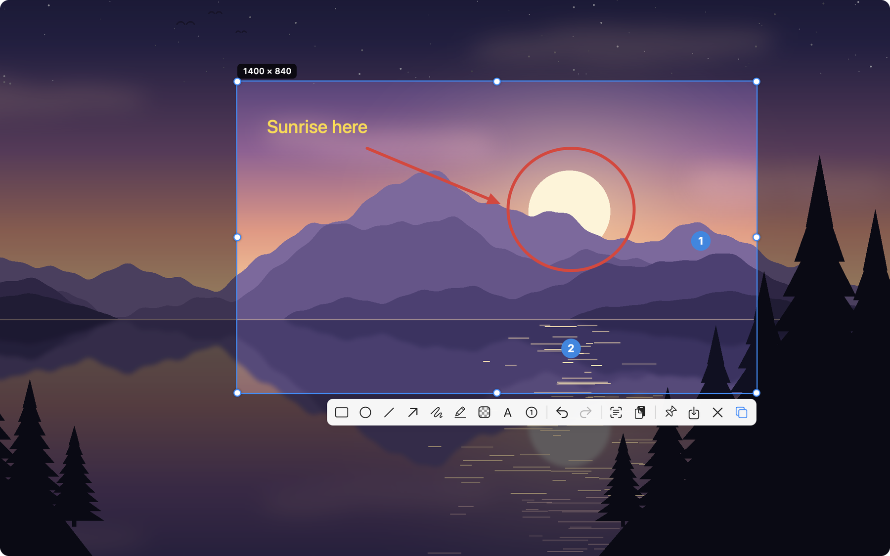
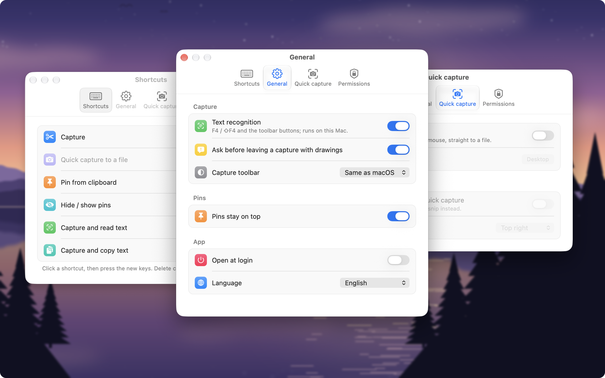

> [!IMPORTANT]
> **sniplite for Mac。** このリポジトリは **macOS** 版のみを管理しています（[`macos`](../macos/README.md)、[Releases](https://github.com/codeime/sniplite/releases/latest) からダウンロード）。**Windows** 版は元のリポジトリからダウンロードしてください：[MrTangLuyao/sniplite](https://github.com/MrTangLuyao/sniplite/releases/latest)。

<div align="center">


# sniplite

**とても軽くて速い、macOS のスクリーンショットとピン留めのツール**

[](../README.md) [](README.zh-CN.md) [](README.zh-TW.md) [](README.ja.md) [](README.ko.md) [](README.fr.md) [](README.de.md) [](README.es.md)

[](https://github.com/codeime/sniplite/releases) [](#ダウンロード) [](../LICENSE)

[**ダウンロード**](#ダウンロード) | [既定のショートカット](#既定のショートカット) | [よくある質問](#よくある質問)


<br>
 
<br>


</div>

## 特長

- **速い**：F1 を押すとすぐにキャプチャでき、すべてのディスプレイに対応
- **自動で選択**：マウスの下のウインドウや、その中の部品（ボタン、入力欄、リスト）を自動で選び、ホイールで外側へ広げられます
- **描き込み**：矩形、楕円、直線、矢印、ペン、マーカー、文字、番号、モザイク。ツールごとに太さと不透明度を記憶し、描いたものはあとから選んで変更できます
- **ピン留め**：キャプチャやコピーした内容をすべてのウインドウの上に固定。拡大縮小、不透明度の変更、再編集ができます
- **文字認識**：キャプチャの文字を、表の列も保って読み取ります。Apple の Vision でこの Mac 上で動きます（任意、既定ではオフ）
- **軽い**：約 1.3 MB、Apple シリコンと Intel にネイティブ対応、待機中のメモリは約 15–25 MB
- **クリーン**：オープンソース、広告なし、データの収集や送信はしません
- **言語**：English、简体中文、繁體中文（システムに合わせて切り替え）

## ダウンロード

[Releases](https://github.com/codeime/sniplite/releases/latest) から `sniplite_<バージョン>_macos.zip` をダウンロードし、展開した `sniplite.app` を「アプリケーション」に移動します。macOS 14 Sonoma 以降が必要です。

sniplite は Apple の公証を受けていないため、最初は macOS にブロックされます（「開けません」または「壊れています」）。「アプリケーション」に移したあと、一度だけ次を実行してください：

```bash
xattr -dr com.apple.quarantine "/Applications/sniplite.app"
```

> [!TIP]
> sniplite はメニューバー（はさみのアイコン）にあり、Dock には表示されません。初回起動時に必要な許可が表示されます：キャプチャ用の「画面収録」と、F1–F12 キーとウインドウの部品の検出用の「アクセシビリティ」です。

## 既定のショートカット

| キー | 動作 |
| --- | --- |
| **F1** | キャプチャ |
| **⇧F1** | クイックキャプチャ：マウスのある画面をそのままファイルに保存（設定でオンにした場合） |
| **F3** | コピーした画像や文字をピン留め |
| **⇧F3** | すべてのピンを隠す / 表示 |
| **F4** / **⇧F4** | キャプチャして文字を読み取る / コピー（文字認識がオンのとき） |
| **Enter** / ダブルクリック | キャプチャをコピー |
| **⌘S** | 保存 |
| **⌘T** / 中クリック | ピン留め |
| **⌘Z** / **⇧⌘Z** | 取り消す / やり直す |
| **Esc** / 右クリック | 一段階戻る。最後はキャンセル |
| **矢印キー**、**W A S D** | 1 ピクセル移動。Shift を押すと 10 ピクセル |
| **ホイール** / 2 本指 | 選択中：大きい / 小さい部品へ。ツール使用中：太さ。ピン上：拡大縮小 |
| **⌥ + ホイール** | ツール使用中：不透明度。ピン上：ピンの不透明度 |
| **⌘E**（ピン上） | ピンにもう一度描き込む |

すべてのショートカットは [macOS 版の README](../macos/README.md#shortcuts) にあります。グローバルショートカットは設定で変更できます。

## よくある質問

**「開けません」「壊れています」と表示されるのはなぜ？**

Apple の公証を受けていないためです。[ダウンロード](#ダウンロード)の `xattr` コマンドを一度実行すると、ダウンロードしたファイルに付く印が外れます。

**F1 を押すと明るさが変わるのはなぜ？**

F1–F12 のショートカットにはアクセシビリティの許可が必要です（macOS 27 では "Device Control and Data Access"）。メニューバーのアイコンの Permissions… から許可してください。

**アップデートのたびに許可し直す必要がありますか？**

通常は必要です。sniplite はアドホック署名のため、macOS はバージョンごとに別のアプリとみなします。sniplite が古い項目を自動で消して許可の画面を開くので、もう一度リストにドラッグしてください。

**キャプチャの文字を読み取るには？**

Settings › General で Text recognition をオンにし、ツールバーの文字ボタン、⌘O、または F4 / ⇧F4 を使います。Apple の Vision でこの Mac 上で動き、何も送信しません。

**メモリはどれくらい使いますか？**

待機中は約 15–25 MB です。キャプチャ中だけ画面の画像を持ち、終わると手放します。

**設定とログはどこにありますか？**

設定はアプリの環境設定にあります（`defaults read io.github.mrtangluyao.sniplite`）。ショートカット、許可、認識時間の簡単なログは `~/Library/Logs/sniplite.log` です。

**アンインストールするには？**

メニューバーから終了し、「アプリケーション」から `sniplite.app` を削除します。設定も消すには `defaults delete io.github.mrtangluyao.sniplite` を実行し、システム設定の「プライバシーとセキュリティ」に残っていればそこからも削除してください。

**Windows 版はありますか？**

はい、元のバージョンです：[MrTangLuyao/sniplite](https://github.com/MrTangLuyao/sniplite/releases/latest)。

## 設定画面



## 自分でビルドする

必要なのは Xcode コマンドラインツール（`xcode-select --install`）だけで、Xcode 本体は要りません。

```bash
cd macos
./build.sh          # build/sniplite.app を作成（Apple シリコン + Intel）
./build.sh --zip    # build/sniplite_<バージョン>_macos.zip も作成
./test.sh           # ユニットテスト
```

ソースは `macos/Sources` にあり、Swift と AppKit で書かれています。署名とコードの構成は [`macos`](../macos/README.md) を参照してください。`macos-v<バージョン>` タグをプッシュすると、GitHub Actions がビルドして Releases に公開します。`src` にある Windows 版のソースは元のリポジトリのもので、ここではビルドしません。

## ライセンス

[MIT](../LICENSE)

## サードパーティのオープンソース

sniplite for Mac は macOS に入っている機能だけを使います。キャプチャは ScreenCaptureKit、ウインドウとその部品の検出はアクセシビリティ API、文字認識は Vision です。サードパーティのコードやモデルは含まれていません。

ドラッグで許可するパネルは、jaywcjlove さんの [PermissionFlow](https://github.com/jaywcjlove/PermissionFlow)（MIT ライセンス）のやり方を参考に、AppKit で書き直したものです。
