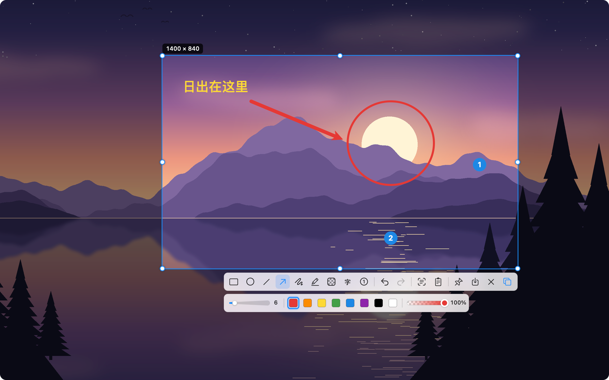
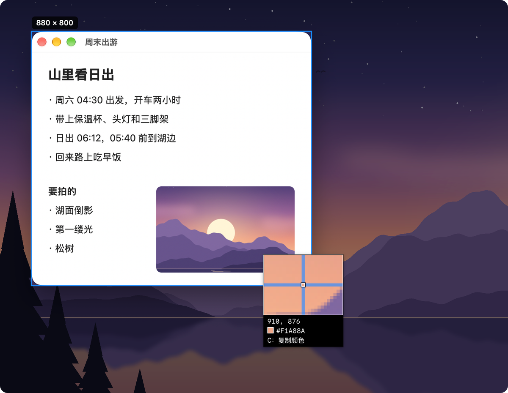
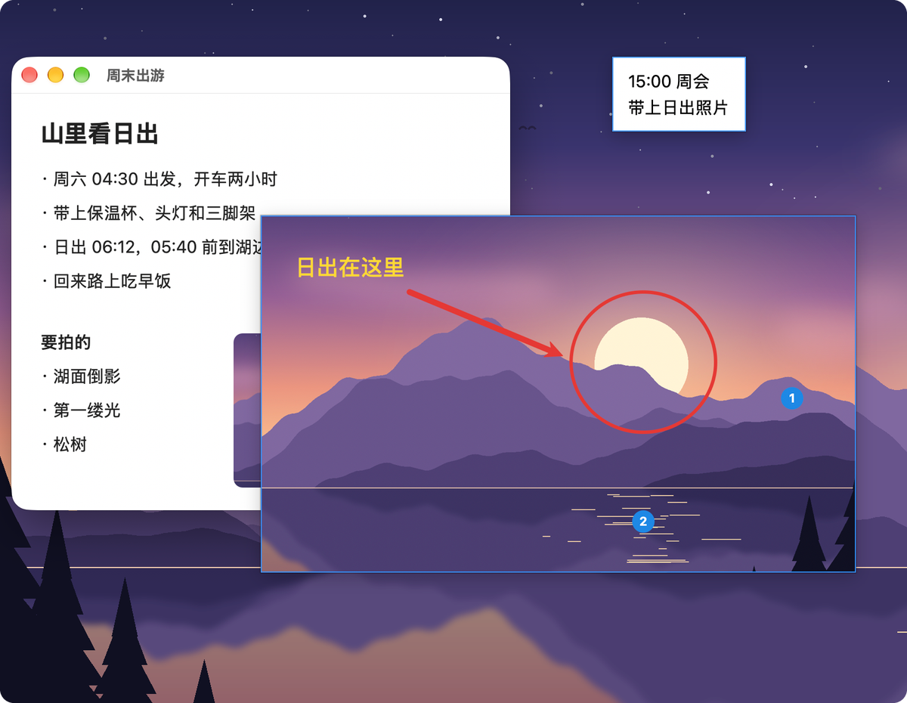
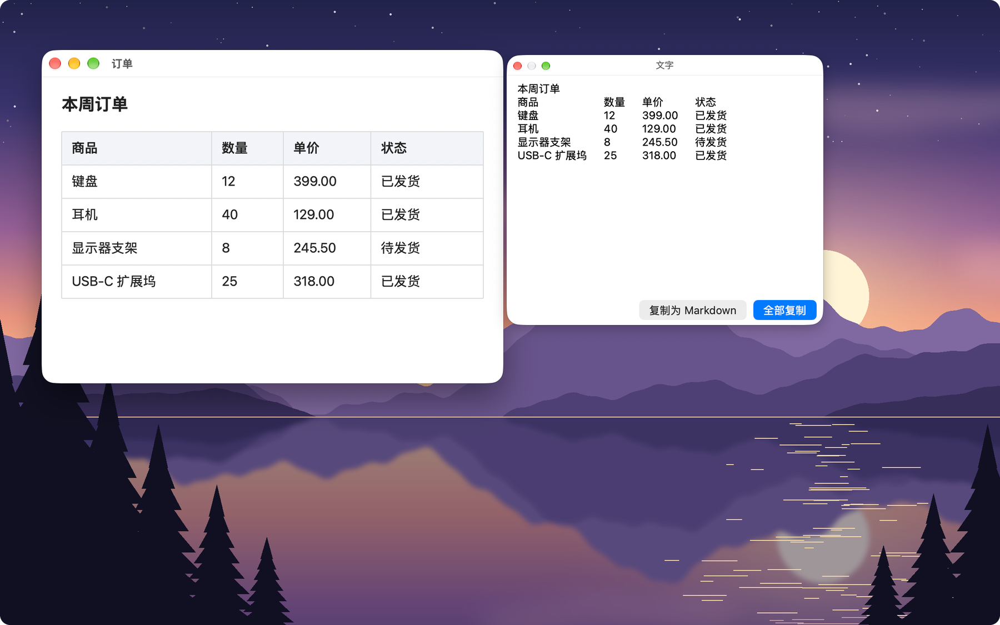
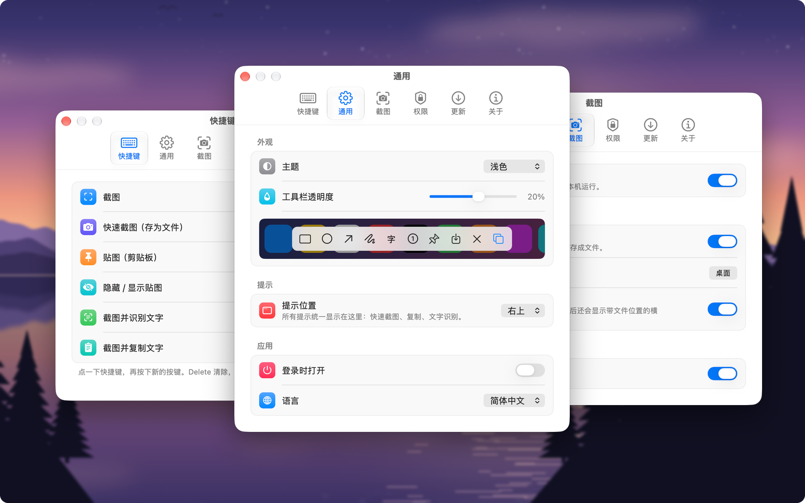

> [!IMPORTANT]
> **sniplite for Mac。** 本仓库只维护 **macOS** 版（在 [`macos`](../macos/README.zh-CN.md) 目录，从 [Releases](https://github.com/codeime/sniplite/releases/latest) 下载）。**Windows** 版请到原仓库下载：[MrTangLuyao/sniplite](https://github.com/MrTangLuyao/sniplite/releases/latest)。

<div align="center">


# sniplite

**轻巧快速的 macOS 截图贴图工具**

[](../README.md) [](README.zh-CN.md) [](README.zh-TW.md) [](README.ja.md) [](README.ko.md) [](README.fr.md) [](README.de.md) [](README.es.md)

[](https://github.com/codeime/sniplite/releases) [](#下载) [](../LICENSE)

[**下载**](#下载) · [默认快捷键](#默认快捷键) · [常见问题](#常见问题)


<br>
 
<br>


</div>

## 特色

- **快**：按 F1 截图立刻就绪，多个显示器同时截
- **自动识别**：自动框出鼠标下的窗口或窗口里的元素（按钮、输入框、列表），滚轮逐级扩大到外层
- **标注**：矩形、椭圆、直线、箭头、画笔、记号笔、文字、序号和马赛克，每种工具各自记住大小和透明度；画好的内容还能选中再改
- **贴图**：把截图或复制的内容贴在所有窗口之上，可以缩放、调透明度、再次编辑
- **文字识别**：识别截图里的文字，表格保持分列，用苹果的 Vision 在本机运行（可选，默认关闭）
- **轻量**：约 2 MB，原生支持 Apple 芯片和 Intel，空闲时内存约 15–25 MB
- **干净**：开源，无广告，不收集、不上传任何数据
- **多语言**：English、简体中文、繁體中文，默认跟随系统

## 下载

从 [Releases](https://github.com/codeime/sniplite/releases/latest) 下载 `sniplite_<版本>_macos.zip`，解压后把 `sniplite.app` 移到"应用程序"。需要 macOS 14 Sonoma 或更高版本。

sniplite 没有经过苹果公证，macOS 第一次会拦下它（提示"无法打开"或"已损坏"）。移到"应用程序"后运行一次：

```bash
xattr -dr com.apple.quarantine "/Applications/sniplite.app"
```

> [!TIP]
> sniplite 在菜单栏（四个角框加一道闪电的图标），程序坞里没有图标。第一次启动会列出需要的权限：屏幕录制用来截图，辅助功能用来响应 F1–F12 和识别窗口里的元素。

## 默认快捷键

| 按键 | 作用 |
| --- | --- |
| **F1** | 截图 |
| **⇧F1** | 快速截图：把鼠标所在的屏幕直接存成文件（在设置里开启后） |
| **F3** | 把复制的图片或文字贴到屏幕上 |
| **⇧F3** | 隐藏 / 显示所有贴图 |
| **F4** / **⇧F4** | 截图并识别 / 复制文字（开启文字识别时） |
| **Enter** / 双击 | 复制截图 |
| **⌘S** | 保存截图 |
| **⌘T** / 鼠标中键 | 贴图 |
| **⌘Z** / **⇧⌘Z** | 撤销 / 重做 |
| **Esc** / 右键 | 逐级后退，最后取消截图 |
| **方向键**、**W A S D** | 移动 1 像素；按住 Shift 移动 10 像素 |
| **滚轮** / 双指滑动 | 选择区域时：更大或更小的元素；选了工具时：调大小；贴图上：缩放 |
| **⌥+滚轮** | 选了工具时：调透明度；贴图上：调贴图透明度 |
| **⌘E**（在贴图上） | 再次编辑贴图 |

全部快捷键见 [macOS 版说明](../macos/README.zh-CN.md#快捷键)；全局快捷键可以在设置里修改。

## 常见问题

**macOS 提示 sniplite"无法打开"或"已损坏"怎么办？**

它没有经过苹果公证。运行一次[下载](#下载)里的 `xattr` 命令即可，它会去掉 macOS 给下载文件加的隔离标记。

**按 F1 为什么是调亮度？**

F1–F12 快捷键需要辅助功能权限（macOS 27 上叫"设备控制和数据访问"）。点菜单栏图标，在"权限…"里开启。

**更新后要重新授权吗？**

通常要：sniplite 用的是临时签名，macOS 会把每个版本当成新应用。sniplite 会自动清掉旧的授权项并打开权限页，重新拖进列表即可。

**怎么识别截图里的文字？**

先在"设置 › 通用"里打开文字识别，然后用工具栏的文字按钮、⌘O，或 F4 / ⇧F4。用苹果的 Vision 在本机运行，不会上传。

**占多少内存？**

空闲时约 15–25 MB。截图时屏幕画面只在截图界面打开期间占用，结束后释放。

**设置和日志在哪里？**

设置存在应用的偏好设置里（`defaults read io.github.codeime.sniplite`）；快捷键、权限和识别耗时的简要日志在 `~/Library/Logs/sniplite.log`。

**怎么卸载？**

从菜单栏退出，把 `sniplite.app` 从"应用程序"删掉。要连设置一起删，运行 `defaults delete io.github.codeime.sniplite`；如果系统设置的"隐私与安全性"里还有它，也一并删掉。

**有 Windows 版吗？**

有，就是原版：[MrTangLuyao/sniplite](https://github.com/MrTangLuyao/sniplite/releases/latest)。

## 首选项



## 自己编译

只需要 Xcode 命令行工具（`xcode-select --install`），不需要安装 Xcode。

```bash
cd macos
./build.sh          # 生成 build/sniplite.app（Apple 芯片 + Intel）
./build.sh --zip    # 同时生成 build/sniplite_<版本>_macos.zip
./test.sh           # 单元测试
```

源码在 `macos/Sources`，用 Swift 和 AppKit 编写；签名方式和代码结构见 [`macos`](../macos/README.zh-CN.md)。推送 `macos-v<版本>` 标签后，GitHub Actions 会自动编译并发布到 Releases。`src` 里的 Windows 版源码来自原仓库，这里不编译。

## 许可证

[MIT](../LICENSE)

## 第三方开源组件

sniplite for Mac 只用 macOS 自带的能力：截图用 ScreenCaptureKit，识别窗口和窗口里的元素用辅助功能接口，识别文字用 Vision。不包含任何第三方代码或模型。

拖拽授权面板参考了 jaywcjlove 的 [PermissionFlow](https://github.com/jaywcjlove/PermissionFlow)（MIT 许可证）的做法，用 AppKit 重写。
