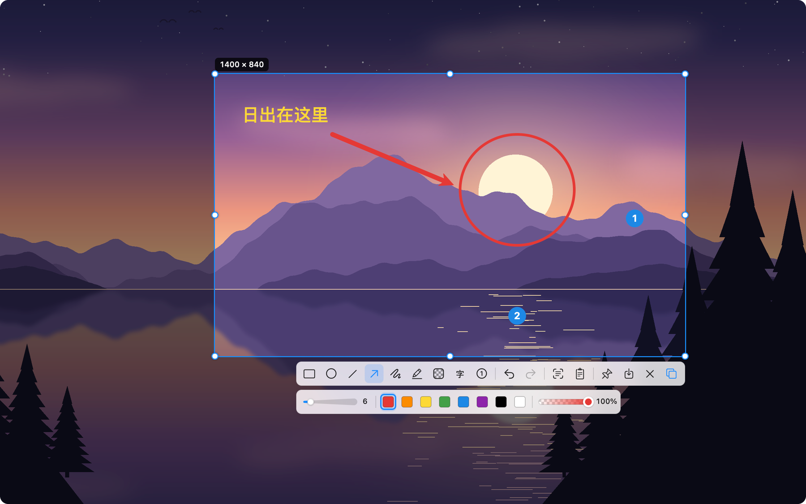
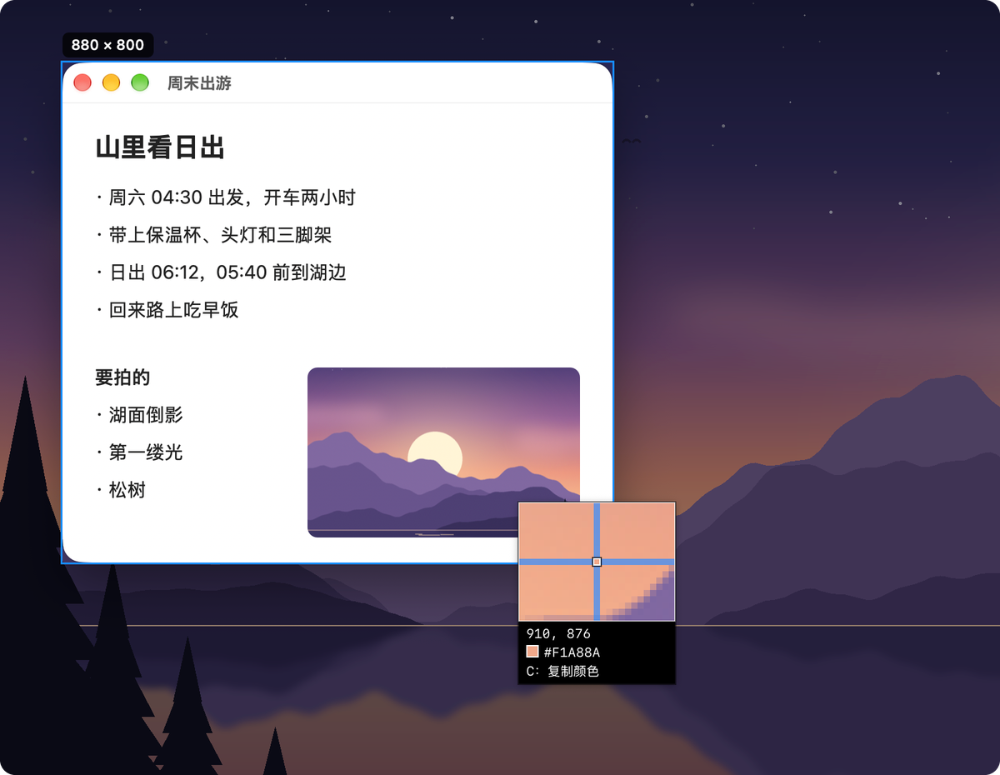
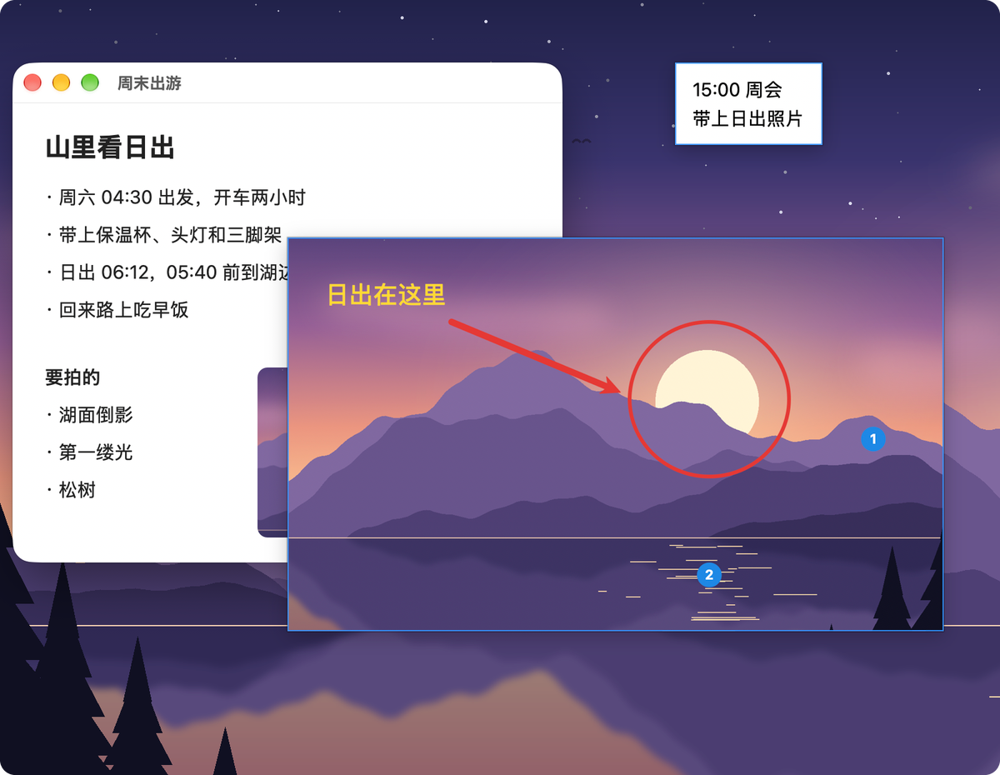
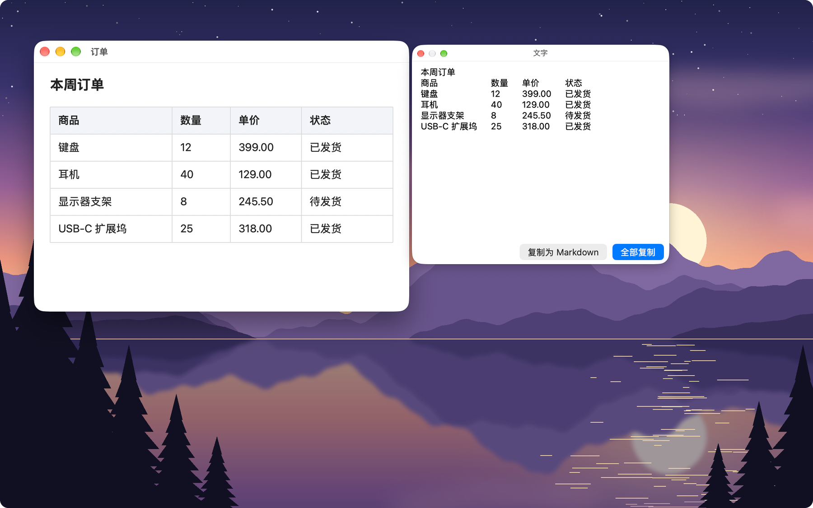
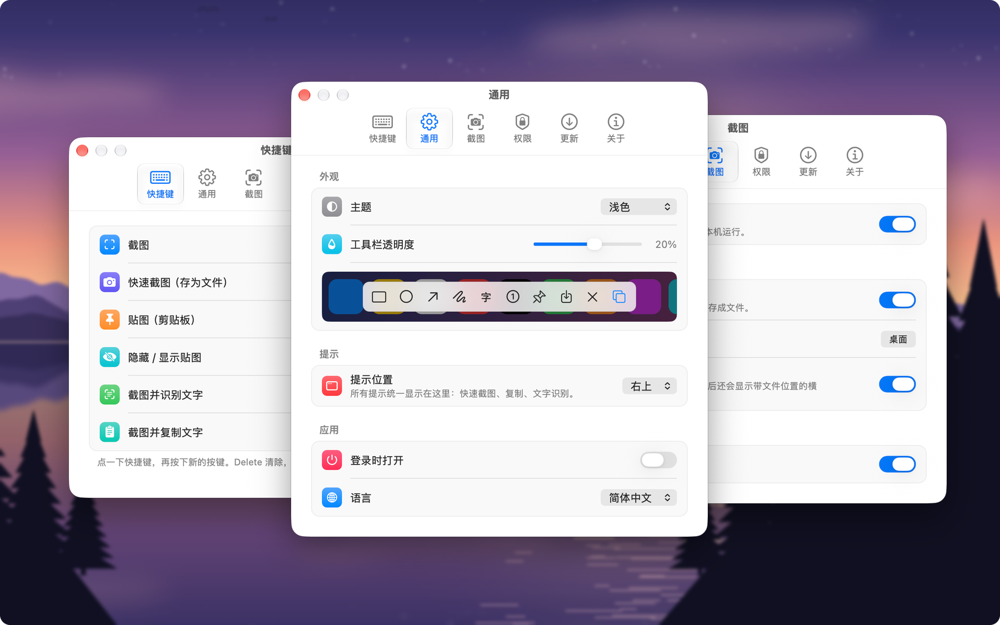

> [!IMPORTANT]
> **sniplite for Mac。** 本倉庫只維護 **macOS** 版（在 [`macos`](../macos/README.md) 資料夾，從 [Releases](https://github.com/codeime/sniplite/releases/latest) 下載）。**Windows** 版請到原倉庫下載：[MrTangLuyao/sniplite](https://github.com/MrTangLuyao/sniplite/releases/latest)。

<div align="center">


# sniplite

**輕巧快速的 macOS 截圖貼圖工具**

[](../README.md) [](README.zh-CN.md) [](README.zh-TW.md) [](README.ja.md) [](README.ko.md) [](README.fr.md) [](README.de.md) [](README.es.md)

[](https://github.com/codeime/sniplite/releases) [](#下載) [](../LICENSE)

[**下載**](#下載) | [預設快速鍵](#預設快速鍵) | [常見問題](#常見問題)


<br>
 
<br>


</div>

## 特色

- **快**：按 F1 截圖立刻就緒，多個顯示器同時截
- **自動辨識**：自動框出滑鼠下的視窗或視窗裡的元素（按鈕、輸入框、列表），滾輪逐級擴大到外層
- **標註**：矩形、橢圓、直線、箭頭、畫筆、螢光筆、文字、序號和馬賽克，每種工具各自記住大小和透明度；畫好的內容還能選取再改
- **貼圖**：把截圖或複製的內容貼在所有視窗之上，可以縮放、調透明度、再次編輯
- **文字辨識**：辨識截圖裡的文字，表格保持分欄，用 Apple 的 Vision 在本機執行（可選，預設關閉）
- **輕量**：約 2.5 MB，原生支援 Apple 晶片和 Intel，閒置時記憶體約 15–25 MB
- **乾淨**：開源，無廣告，不收集、不上傳任何資料
- **多語言**：English、简体中文、繁體中文，預設跟隨系統

## 下載

從 [Releases](https://github.com/codeime/sniplite/releases/latest) 下載 `sniplite_<版本>_macos.zip`，解壓縮後把 `sniplite.app` 移到「應用程式」。需要 macOS 14 Sonoma 或更新版本。

sniplite 沒有經過 Apple 公證，macOS 第一次會擋下它（顯示「無法打開」或「已損毀」）。移到「應用程式」後執行一次：

```bash
xattr -dr com.apple.quarantine "/Applications/sniplite.app"
```

> [!TIP]
> sniplite 在選單列（四個角框加一道閃電的圖示），Dock 裡沒有圖示。第一次啟動會列出需要的權限：螢幕錄製用來截圖，輔助使用用來回應 F1–F12 和辨識視窗裡的元素。

## 預設快速鍵

| 按鍵 | 作用 |
| --- | --- |
| **F1** | 截圖 |
| **⇧F1** | 快速截圖：把滑鼠所在的螢幕直接存成檔案（在設定裡開啟後） |
| **F3** | 把複製的圖片或文字貼到螢幕上 |
| **⇧F3** | 隱藏 / 顯示所有貼圖 |
| **F4** / **⇧F4** | 截圖並辨識 / 複製文字（開啟文字辨識時） |
| **Enter** / 按兩下 | 複製截圖 |
| **⌘S** | 儲存截圖 |
| **⌘T** / 滑鼠中鍵 | 貼圖 |
| **⌘Z** / **⇧⌘Z** | 還原 / 重做 |
| **Esc** / 右鍵 | 逐級後退，最後取消截圖 |
| **方向鍵**、**W A S D** | 移動 1 像素；按住 Shift 移動 10 像素 |
| **滾輪** / 雙指滑動 | 選擇區域時：更大或更小的元素；選了工具時：調大小；貼圖上：縮放 |
| **⌥+滾輪** | 選了工具時：調透明度；貼圖上：調貼圖透明度 |
| **⌘E**（在貼圖上） | 再次編輯貼圖 |

全部快速鍵見 [macOS 版說明](../macos/README.zh-CN.md#快捷键)；全域快速鍵可以在設定裡修改。

## 常見問題

**macOS 顯示 sniplite「無法打開」或「已損毀」怎麼辦？**

它沒有經過 Apple 公證。執行一次[下載](#下載)裡的 `xattr` 指令即可，它會去掉 macOS 給下載檔案加的隔離標記。

**按 F1 為什麼是調亮度？**

F1–F12 快速鍵需要輔助使用權限（macOS 27 上叫「裝置控制和資料取用」）。點選單列圖示，在「權限…」裡開啟。

**更新後要重新授權嗎？**

通常要：sniplite 用的是臨時簽署，macOS 會把每個版本當成新 App。sniplite 會自動清掉舊的授權項目並打開權限頁，重新拖進列表即可。

**怎麼辨識截圖裡的文字？**

先在「設定 › 一般」裡打開文字辨識，然後用工具列的文字按鈕、⌘O，或 F4 / ⇧F4。用 Apple 的 Vision 在本機執行，不會上傳。

**佔多少記憶體？**

閒置時約 15–25 MB。截圖時螢幕畫面只在截圖介面打開期間佔用，結束後釋放。

**設定和日誌在哪裡？**

設定存在 App 的偏好設定裡（`defaults read io.github.codeime.sniplite`）；快速鍵、權限和辨識耗時的簡要日誌在 `~/Library/Logs/sniplite.log`。

**怎麼解除安裝？**

從選單列結束，把 `sniplite.app` 從「應用程式」刪掉。要連設定一起刪，執行 `defaults delete io.github.codeime.sniplite`；如果系統設定的「隱私權與安全性」裡還有它，也一併刪掉。

**有 Windows 版嗎？**

有，就是原版：[MrTangLuyao/sniplite](https://github.com/MrTangLuyao/sniplite/releases/latest)。

## 偏好設定



## 自己編譯

只需要 Xcode 命令列工具（`xcode-select --install`），不需要安裝 Xcode。

```bash
cd macos
./build.sh          # 產生 build/sniplite.app（Apple 晶片 + Intel）
./build.sh --zip    # 同時產生 build/sniplite_<版本>_macos.zip
./test.sh           # 單元測試
```

原始碼在 `macos/Sources`，以 Swift 和 AppKit 撰寫；簽署方式和程式結構見 [`macos`](../macos/README.zh-CN.md)。推送 `macos-v<版本>` 標籤後，GitHub Actions 會自動編譯並發佈到 Releases。`src` 裡的 Windows 版原始碼來自原倉庫，這裡不編譯。

## 授權

[MIT](../LICENSE)

## 第三方開源元件

sniplite for Mac 只用 macOS 內建的能力：截圖用 ScreenCaptureKit，辨識視窗和視窗裡的元素用輔助使用介面，辨識文字用 Vision。不包含任何第三方程式碼或模型。

拖曳授權面板參考了 jaywcjlove 的 [PermissionFlow](https://github.com/jaywcjlove/PermissionFlow)（MIT 授權）的做法，以 AppKit 重寫。
